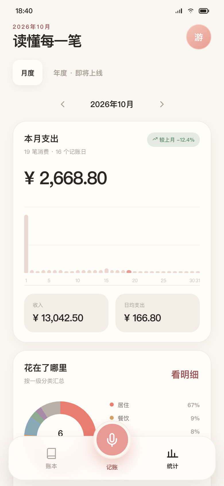
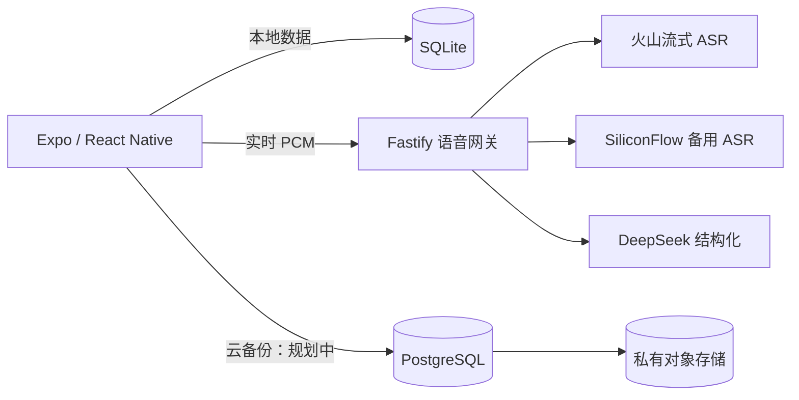

<p align="center">
  
</p>

<p align="center">
  <a href="https://github.com/zhixiang-luo/shengzhang/actions/workflows/ci.yml"></a>
  
  
  
  
  <a href="LICENSE"></a>
</p>

<p align="center">
  一款面向中国内地年轻个人用户的语音优先记账应用。<br />
  按住说一句，账单自动生成。
</p>

## 为什么做声账

我平时会记账，也用过一些记账工具。但每次付款后，仍然需要打开应用、选择分类、输入商品和金额。记账这件事本身不复杂，麻烦的是它总在打断正在发生的生活。

我想要的工具更简单：**不用整理句式，不用逐项点击，一句话就能把账记好。**

所以有了声账。

它不是要成为功能最多的记账软件，而是想成为从付款到记账之间最短的一条路。应用坚持语音优先、本地优先和克制的视觉表达，让记录足够快、界面足够安静、数据边界足够清楚。

这个项目也是我作为独立开发者完成的第一个完整应用。从产品定义、交互设计、React Native 客户端、Fastify 语音网关到服务器部署，由我负责整体设计与实现；开发过程中使用 AI 编程工具辅助编码、测试和文档整理。

## 产品截图

以下截图来自已评审的交互原型，正式 App 截图会随内测版本持续更新。

| 一句话多笔记账 | 月度统计 | 手动记账兜底 |
| :---: | :---: | :---: |
|  |  |  |

## 为谁而做

声账主要面向 **18–35 岁的学生和年轻职场人**：他们有日常消费，也愿意了解自己的钱花在哪里，但不想维护复杂表格，不愿意为了记一笔账经过多层页面。

典型使用场景：

- 午餐后说一句“午饭 25，咖啡 18”；
- 打车后说一句“打车 32”；
- 收到工资后说一句“今天工资到账 8000”；
- 忘记分类或金额时，再通过手动记账补齐。

## 核心体验

1. 按住底部“记账”按钮开始说话。
2. 火山流式 ASR 实时返回文字。
3. 松手后由 DeepSeek 提取金额、收支类型、分类、日期和备注。
4. 多笔账单自动写入本地 SQLite，并展示合并结果。
5. 保存后 8 秒内可以整批撤销。

语音是主路径，手动记账是稳定兜底。首次启动不要求登录，网络或云服务失败也不会阻塞本地账本。

## 当前能力

| 模块 | 状态 |
| --- | --- |
| 语音流式录音与实时字幕 | ✅ 已接入真实火山 ASR |
| 一句话多笔、自动分类与时间解析 | ✅ 已接入 DeepSeek 结构化 |
| 语音结果自动入账、8 秒撤销 | ✅ 已完成 |
| 手动记账、金额计算键盘、备注 | ✅ 已完成 |
| 两级自定义分类、拖拽排序、归档 | ✅ 已完成 |
| 月度统计、分类下钻、每日明细 | ✅ 已完成 |
| 本地 SQLite 与删除撤销 | ✅ 已完成 |
| Android 内测 APK | ✅ 已通过 EAS Build |
| 官网首版与移动端下载入口 | ✅ 已完成，等待域名发布 |
| 匿名产品统计与用户开关 | ✅ 已完成 |
| 30–50 条真人语音与双端真机矩阵 | 🚧 进行中 |
| 月末回顾、JSON/CSV 导出、隐私中心 | 🚧 规划中 |
| 微信登录、云备份、会员与支付 | 🧭 外部依赖就绪后再启动 |

项目当前处于 **M5 内测与质量验证阶段**。它已经可以完整跑通真实语音记账，但还没有作为正式商业版本上架。

## 技术亮点

- **语音优先状态机**：录音、实时转写、取消、手动切换、结构化、自动保存和撤销都有明确状态。
- **本地优先**：账单首先写入 SQLite，网络、登录和云备份不是记账前置条件。
- **共享领域模型**：金额统一使用整数分，客户端、服务端和测试共用 Zod 契约与领域函数。
- **流式语音链路**：手机 PCM → Fastify WebSocket → 火山双向流式 ASR → DeepSeek 结构化。
- **隐私边界明确**：录音仅用于本次识别，服务端不长期保存音频；语音模型不接收历史账单。
- **可验证质量**：200 条中文 TTS 语音基线全部通过，当前仓库包含 52 项自动化测试。

### 架构概览



详细设计见 [技术架构](docs/09-technical-architecture.md)、[语音记账规格](docs/05-voice-accounting.md) 和 [AI 供应商配置](docs/19-ai-providers.md)。

## 工程质量

| 验证项 | 当前结果 |
| --- | --- |
| TypeScript 严格检查 | 通过 |
| ESLint | 通过 |
| 自动化测试 | 52 / 52 通过 |
| Expo Doctor | 20 / 20 通过 |
| 中文 TTS 语音评测 | 200 / 200 通过 |
| 松手到结构化完成 | P50 1.68s / P95 2.20s |
| Android EAS 内测构建 | 通过 |
| iOS / Android Bundle 导出 | 通过 |

200 条语音结果来自合成的中文 TTS 基线，不等同于真人噪声、口音和弱网环境。项目仍在补充真人语料与双端真机矩阵。

## 快速开始

环境要求：Node.js 22+、pnpm 11+。

```bash
pnpm install
pnpm typecheck
pnpm lint
pnpm test
```

启动移动端：

```bash
pnpm dev:mobile
```

手机安装 Expo Go，并与电脑保持在同一局域网，然后扫描终端二维码。

启动本地语音网关：

```bash
pnpm dev:api
```

复制 `.env.example` 为 `.env`，按需填写：

```text
DEEPSEEK_API_KEY=your_key
VOLCENGINE_ASR_API_KEY=your_key
VOLCENGINE_ASR_RESOURCE_ID=your_resource_id
SILICONFLOW_API_KEY=your_backup_key
```

真实密钥只允许存在于本地或服务端环境变量中，不要提交到仓库。

## 可点击原型

原型不依赖构建工具：

```bash
cd prototype
python3 -m http.server 4173
```

打开 `http://localhost:4173`，或直接查看 [原型截图](prototype/screenshots/) 和 [原型预览总览](preview/prototype-contact-sheet.png)。

## 项目结构

```text
声账/
├── apps/mobile/       Expo + React Native 双端应用
├── services/api/      语音、账号与备份网关
├── packages/
│   ├── contracts/     Zod 接口契约与共享 DTO
│   └── domain/        金额、分类、排序和统计纯函数
├── docs/              产品、技术、隐私、评测与部署文档
├── design/            品牌资产、设计令牌与导出资源
├── prototype/         可点击交互原型与关键页面截图
├── deploy/            Nginx、systemd 与服务器初始化配置
└── preview/           GitHub 浏览用预览资源
```

## 文档导航

- [项目上下文：5 分钟了解声账](docs/00-project-context.md)
- [产品需求与 MVP 边界](docs/01-prd.md)
- [用户流程](docs/03-user-flows.md)
- [语音记账设计](docs/05-voice-accounting.md)
- [技术架构](docs/09-technical-architecture.md)
- [语音评测报告](docs/20-voice-eval-report.md)
- [后期产品战略](docs/21-post-mvp-strategy.md)
- [生产基础设施与上线清单](docs/26-production-infrastructure.md)
- [当前开发交接](docs/HANDOFF.md)

## 路线图

### 正在做

- 扩充真人、口音、噪声和弱网语音测试；
- 完成 iOS / Android 中低端真机矩阵；
- 打磨月末回顾、导出和个人数据管理。

### 后续

- 云备份与手动恢复；
- 可控制的分享卡片与隐私中心；
- 多平台发布和更完整的无障碍支持。

### 外部依赖就绪后

- 微信登录；
- 会员权益与支付；
- 社区推广和邀请机制。

产品范围和技术边界以 [实施路线图](docs/14-implementation-roadmap.md) 为准。

## 下载与发布

Android 内测 APK 可从[声账官网下载](http://8.152.201.57/#download)，无需 Expo 或 GitHub 账户。版本说明和 SHA-256 记录在 [GitHub Releases](https://github.com/zhixiang-luo/shengzhang/releases)。APK 不直接提交到 Git 仓库，避免仓库体积膨胀并保留版本记录。

当前尚未在 App Store 或国内 Android 应用商店正式上架。

## 开源与隐私

这是一个开放源代码项目。公开代码的目的，是让用户、开发者和面试官能够看到应用如何工作、账单如何处理，以及哪些数据留在本地、哪些请求会发送到服务端。

请不要在 Issue、截图或提交中上传真实账单、录音、密钥、手机号或微信身份信息。

源码依据 [MIT License](LICENSE) 开放，但“声账”名称、Logo、小猪角色和官方视觉不随代码一并授权；发布衍生版本时请使用不同品牌。具体边界见 [TRADEMARK.md](TRADEMARK.md)。

公开源码不包含模型或云服务密钥，也不授予任何人无限调用维护者线上语音服务的权利。自部署者需要在服务端配置自己的供应商账号并承担相应费用。线上 API 应通过安装额度、限流、预算告警和停用开关控制成本，详细规则见 [开源项目运营边界](docs/28-open-source-operations.md)。

## 参与贡献

欢迎提交 Issue、改进建议和 Pull Request。开始前请阅读 [贡献指南](CONTRIBUTING.md) 和 [安全策略](SECURITY.md)。

## English Summary

**Shengzhang** is a voice-first personal bookkeeping app for young users in mainland China. Hold the record button, speak naturally, and the app creates one or more transactions automatically. It combines streaming ASR, LLM-based structured extraction, local-first SQLite storage, manual entry, category management, and monthly statistics in one Expo / React Native application.

This is an independent developer project covering product design, mobile development, backend engineering, AI integration, testing, and deployment.

## License

[MIT](LICENSE) © 2026 zhixiang-luo
