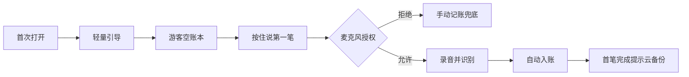
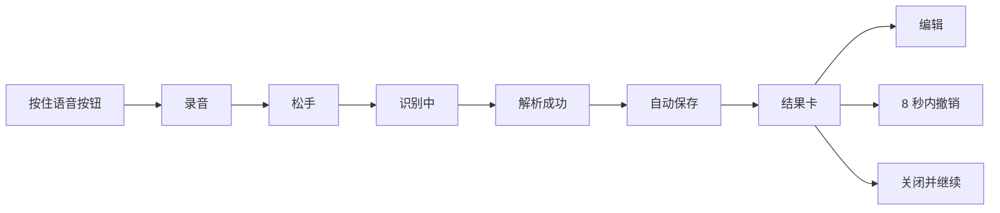
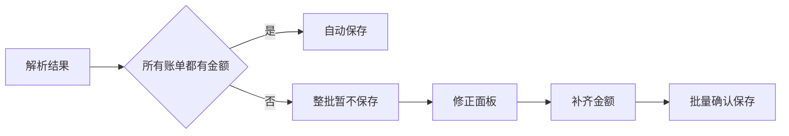
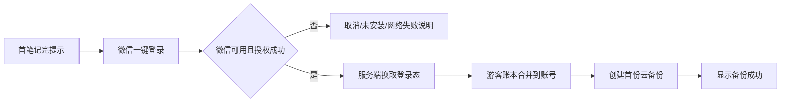
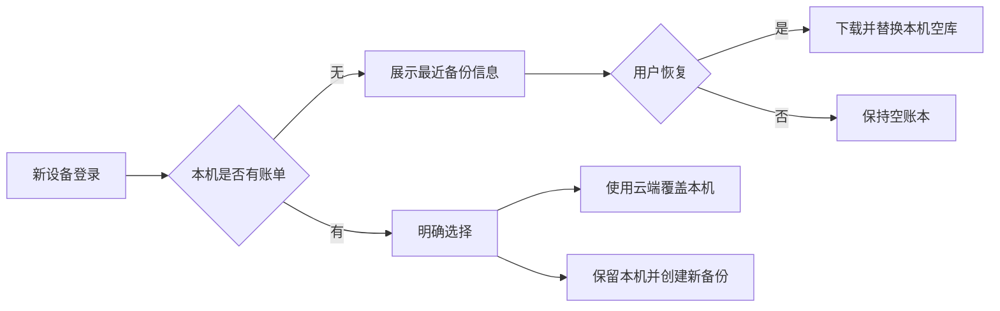
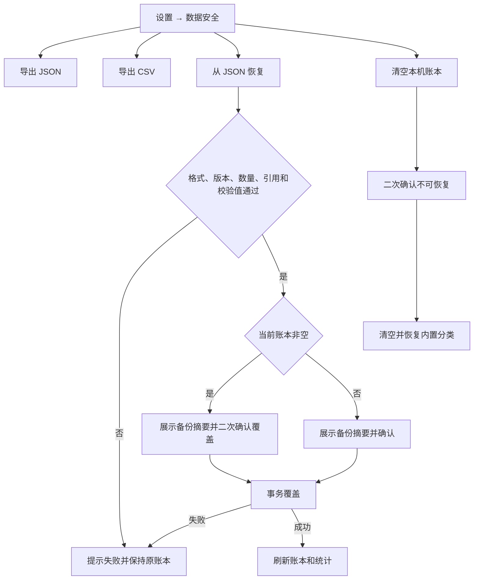
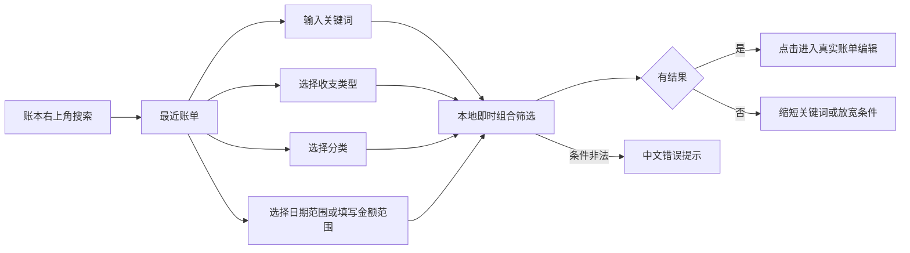
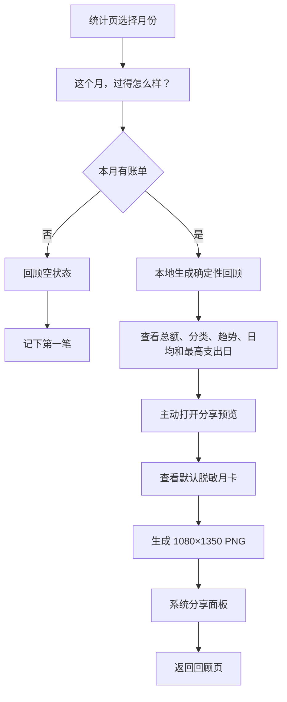

# 核心用户流程

## 1. 游客首次记账



关键文案：

- 引导：`按住说一句，金额、分类、日期都会替你填好。`
- 权限：`需要使用麦克风听取账单内容。录音仅用于本次云端识别。`
- 首笔后：`第一笔记好了。登录微信，换手机也能找回账本。`

登录提示只出现一次，按钮为 `微信一键登录` 和 `以后再说`。

## 2. 单笔语音

底部“记账”按钮直接承担按住录音功能。按下即开始，松手即识别；中间不出现需要再次点击“语音入账”的步骤。



结果卡示例：

> 已记好  
> 餐饮 · 午餐　¥25.00　今天 12:31  
> 点这条账可修改　`撤销`　`收好`

结果卡中的每一笔账单使用本次批量保存返回的真实交易 ID 打开编辑。用户进入单笔编辑后，本次批量结果卡结束，不再同时提供整批撤销，避免已修改账单被静默删除。未进入编辑前，撤销仍按整次语音批次删除。

## 3. 一句话多笔

用户说：`午饭 25，打车 18，咖啡 16`

系统生成三笔账单，共用同一 `voiceRequestId`：

- 餐饮 / 午餐 / 25 元
- 交通 / 打车 / 18 元
- 餐饮 / 咖啡奶茶 / 16 元

结果卡标题为 `已记好 3 笔`。逐笔编辑后，撤销范围只包含本次语音且未被编辑的账单；对已修改账单执行撤销时需二次确认。

超过 5 笔时不保存，文案：`一次最多记 5 笔，请拆成两句话说。`

## 4. 缺金额



- 保留已识别的类型、时间、分类和备注。
- 将金额输入框置为焦点，未解决的项目高亮。
- 只为缺金额的条目提供输入框；已有金额的条目只读，入账后可点结果卡逐笔修改。
- 用户放弃时整批不保存，也不保留录音页的转写；想重来就再按住说一遍。

## 5. 手动记账

1. 空账本点击“加一笔”，或点击底部语音按钮后向右滑进入手动记账。
2. 默认支出、当前时间、最近使用分类。
3. 点击时间卡片打开月历，选择任意日期和具体时刻；也可使用今天、昨天、前天快捷项。
4. 输入金额，选择分类，可补充备注。
5. 点击保存，面板关闭，账单插入正确日期位置。
6. 编辑和删除复用同一面板与删除确认。
7. 账本列表单笔账单支持向左滑动露出“删除”，删除后沿用 8 秒撤销。

分类区提供“新建分类”。用户可以选择创建一级分类，或在当前一级分类下创建二级分类；保存后新分类立即被选中。分类管理页长按分类行主体约半秒后可直接拖动排序，单击仍执行展开或编辑，松手后持久化整组顺序。

## 6. 微信登录与首次备份



- 登录不阻塞记账。
- 授权失败回到触发页，不丢失当前账单。
- 首次备份必须包含登录前所有本地账单和自定义分类。
- 退出登录后本机账本保留，备份状态改为未开启。

## 7. 自动备份

本地写入成功后标记 `pending`，在满足任一条件时上传：

- 停止编辑 5 秒。
- App 进入后台。
- 用户点击“立即备份”。

状态机：

```text
none -> pending -> backing_up -> succeeded
                         └----> failed -> pending
```

- 失败不阻塞用户记账，只显示轻量状态。
- 连续失败时在设置页显示人话原因和重试按钮。
- 备份内容为完整快照，带版本号、设备 ID、更新时间和校验值。

## 8. 新设备恢复



禁止静默覆盖。覆盖前必须提示云端备份的账单数量、最近备份时间，并要求二次确认。

## 9. 异常恢复

| 场景 | 用户看到 | 主操作 |
| --- | --- | --- |
| 首次请求麦克风 | 先说明录音用途、处理方式和历史账单边界 | 继续使用语音 / 手动记账 / 取消 |
| 麦克风拒绝 | 说明无法听到语音，手动记账仍可用 | 重试 / 手动记账 / 取消 |
| 识别失败 | 保留已经听到的临时文字，不自动关闭错误面板 | 重新说 / 手动记账 / 取消 |
| 账单整理失败 | 保留完整转写，不再次要求用户说话 | 重新整理 / 手动记账 / 取消 |
| 额度耗尽 | 今日语音次数已用完 | 明天再试 / 手动记账 |
| 微信未安装 | 需要安装微信才能一键登录 | 返回 |
| 微信授权取消 | 没有登录或备份 | 重新登录 / 稍后 |
| 备份失败 | 本机已保存，云备份稍后重试 | 立即重试 |
| 恢复失败 | 本机账本未改变 | 重试 / 联系反馈 |

异常面板不得自动消失。用户选择“手动记账”时，已经保留的转写作为新账单备注预填，金额和分类仍由用户确认。

## 9.1 本地导出、恢复与清空



- JSON 是唯一恢复格式；CSV 只用于查看。
- 覆盖恢复不合并两份账本。
- 当前没有云备份，页面必须明确提示先导出再换机或清空。

## 10. 搜索账单



- 默认结果按账单时间和创建时间倒序，不依赖网络。
- 关键词匹配备注、一级分类和二级分类。
- 类型、分类、日期和金额条件全部使用 AND 组合。
- 开始和结束日期点击后复用月历 Sheet 直接选择，不弹出日期文字键盘；每个日期可单独清除。
- 搜索结果显示分类路径、日期时间和金额，点击打开真实账单。
- 清除筛选后回到最近账单，不修改任何账目。

## 11. 首次使用说明

- 仅当本机账本为空且当前引导版本尚未完成时展示。
- 说明“按住说一句、松手自动入账、点结果中的一笔可修改”。
- 同时提供“手动记一笔”，不把语音能力作为记账前置条件。
- 点击“知道了”或手动入口后，以版本号持久化完成状态；后续启动不重复遮挡。
- 首次请求麦克风前先展示用途说明，不直接弹系统授权框。

## 12. 月度回顾与分享



- 回顾数字必须与统计页来自同一份本地账单和整数分规则。
- 空月份仍允许进入回顾，只显示“这个月还很安静”和手动记账入口。
- 分享预览是实际导出内容，不展示金额、备注、商户、分类名或精确日期。
- 关闭预览或取消系统分享不修改账本，也不产生“分享成功”的虚假统计。
- 分享卡依赖原生截图模块，因此已有安装包不能只通过 OTA 获得该能力。

## 13. 付款页快捷记账（Android 0.3.3）

1. 首次在设置同意截图上云，配置无障碍及磁贴；系统确认添加后自动打勾，移除后恢复。只用简短说明提示部分机型可在系统设置绑定手势；后续主动点击直接识别。
2. 停在微信/支付宝单笔详情，点击入口，隐藏自身窗口并截图；原页面出现识别中卡，不打开声账主 App。
3. 直接云端视觉识别，不执行本地 OCR。金额、商品或商户、时间及一个已有分类显示在默认无滚动卡上。
4. 有误时点字段修改；晚到结果/重识别不覆盖人工编辑。未知金额保持空值，补齐前不可保存；缺时间固定采集时刻并标来源。
5. 点一次“确定收好了”写入现有账本，成功提示并收起，没有第二页、第二次确认或快捷记账撤销。返回 App 时刷新账本。失败保留编辑，可重试。
6. 关闭、切其他 App、锁屏、授权撤回或五分钟到期后取消任务，旧结果不接受。

单张截图分享走应用内同样简卡，无需无障碍；无授权时先看图片与说明，拒绝后可手填。分享副本保存/取消后清理，进程死亡后在下次访问清理过期文件。明确失败、待付款、退款、转账、外币强阻断；银行仅尝试可截图单笔分享，安全窗口无法绕过。iOS 与厂商手势边界见 [40](./40-shortcut-platform-support.md)，当前反馈与验证见 [42](./42-quick-accounting-device-feedback.md)。
