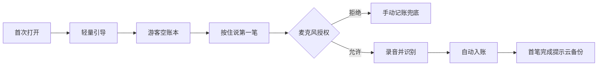
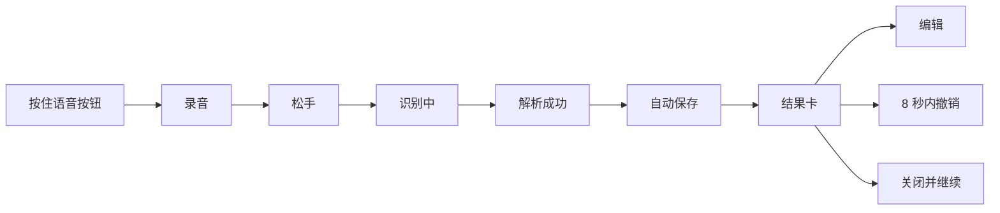
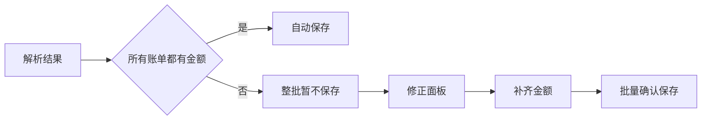
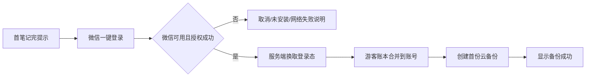
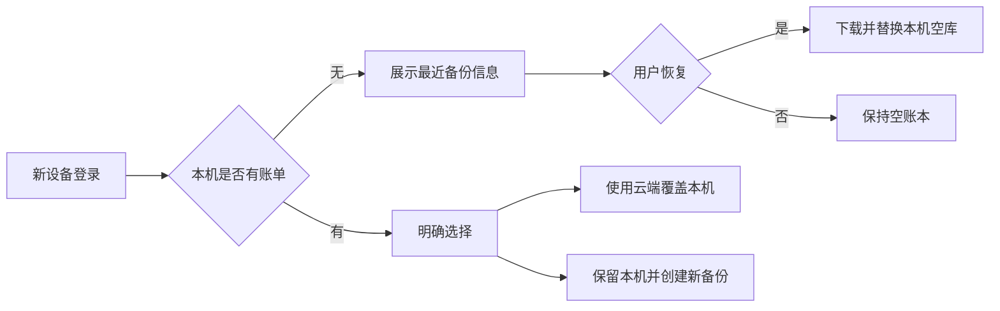

# 核心用户流程

## 1. 游客首次记账



关键文案：

- 引导：`按住说一句，金额、分类、日期都会替你填好。`
- 权限：`需要使用麦克风听取账单内容。录音仅用于本次云端识别。`
- 首笔后：`第一笔记好了。登录微信，换手机也能找回账本。`

登录提示只出现一次，按钮为 `微信一键登录` 和 `以后再说`。

## 2. 单笔语音

底部“记账”按钮直接承担按住录音功能。按下即开始，松手即识别；中间不出现需要再次点击“语音入账”的步骤。



结果卡示例：

> 已记好  
> 餐饮 · 午餐　¥25.00　今天 12:31  
> `编辑`　`撤销`

撤销操作必须删除整次语音生成的账单；如果用户已经编辑其中某一笔，仍提供“仅撤销未修改项”和“全部撤销”的明确处理。

## 3. 一句话多笔

用户说：`午饭 25，打车 18，咖啡 16`

系统生成三笔账单，共用同一 `voiceRequestId`：

- 餐饮 / 午餐 / 25 元
- 交通 / 打车 / 18 元
- 餐饮 / 咖啡奶茶 / 16 元

结果卡标题为 `已记好 3 笔`。逐笔编辑后，撤销范围只包含本次语音且未被编辑的账单；对已修改账单执行撤销时需二次确认。

超过 5 笔时不保存，文案：`一次最多记 5 笔，请拆成两句话说。`

## 4. 缺金额



- 保留已识别的类型、时间、分类和备注。
- 将金额输入框置为焦点，未解决的项目高亮。
- 用户取消时整批不保存，并在录音页保留可重试的文本结果。

## 5. 手动记账

1. 点击账本右上角 `+`。
2. 默认支出、当前时间、最近使用分类。
3. 输入金额，选择分类，可补充备注。
4. 点击保存，面板关闭，账单插入正确日期位置。
5. 编辑和删除复用同一面板与删除确认。

## 6. 微信登录与首次备份



- 登录不阻塞记账。
- 授权失败回到触发页，不丢失当前账单。
- 首次备份必须包含登录前所有本地账单和自定义分类。
- 退出登录后本机账本保留，备份状态改为未开启。

## 7. 自动备份

本地写入成功后标记 `pending`，在满足任一条件时上传：

- 停止编辑 5 秒。
- App 进入后台。
- 用户点击“立即备份”。

状态机：

```text
none -> pending -> backing_up -> succeeded
                         └----> failed -> pending
```

- 失败不阻塞用户记账，只显示轻量状态。
- 连续失败时在设置页显示人话原因和重试按钮。
- 备份内容为完整快照，带版本号、设备 ID、更新时间和校验值。

## 8. 新设备恢复



禁止静默覆盖。覆盖前必须提示云端备份的账单数量、最近备份时间，并要求二次确认。

## 9. 异常恢复

| 场景 | 用户看到 | 主操作 |
| --- | --- | --- |
| 麦克风拒绝 | 说明无法听到语音，手动记账仍可用 | 去设置 / 手动记账 |
| 网络失败 | 未上传，已有账本不受影响 | 重试 / 手动记账 |
| 额度耗尽 | 今日语音次数已用完 | 明天再试 / 手动记账 |
| 微信未安装 | 需要安装微信才能一键登录 | 返回 |
| 微信授权取消 | 没有登录或备份 | 重新登录 / 稍后 |
| 备份失败 | 本机已保存，云备份稍后重试 | 立即重试 |
| 恢复失败 | 本机账本未改变 | 重试 / 联系反馈 |
