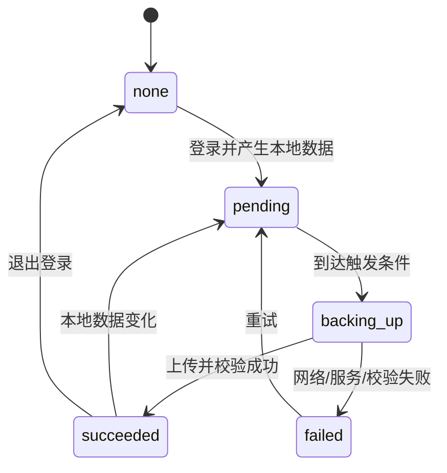

# 账号与云备份

## 1. 产品定义

账号用于建立云备份归属，不改变本地优先的产品形态。声账首版提供：

- 游客本地记账。
- 微信移动端一键登录。
- 登录后的自动云备份。
- 新设备手动恢复。

首版不提供微信扫码登录、Web 端或实时多端同步。

## 2. 微信登录

- 平台：微信开放平台移动应用。
- 能力：微信 SDK 发起授权，服务端使用授权码换取 `access_token` 和用户标识。
- 不在客户端保存 AppSecret。
- 获取的数据仅包括微信用户唯一标识、昵称和头像 URL，头像可不展示。
- 登录前必须明确说明登录用途是“开启云备份与换机恢复”。
- 登录失败、取消或微信未安装都必须回到原页面，不改变本地账本。

## 3. 游客数据合并

首次登录时：

1. 验证微信登录态。
2. 检查当前账号是否已有云备份。
3. 无备份：把当前本地账本作为首份备份上传。
4. 有备份且本地为空：询问是否恢复云端备份。
5. 有备份且本地有数据：要求用户在“使用云端覆盖本机”和“保留本机并创建新备份”之间选择。

禁止自动合并两份不同来源的账本。MVP 的云备份是快照，不承担实时双向同步。

## 4. 备份触发

- 登录成功并完成游客数据合并后立即备份。
- 本地账单或分类写入后标记 `pending`。
- 停止编辑 5 秒后自动备份。
- App 进入后台时尝试备份。
- 用户可在云备份页点击“立即备份”。
- 手动导出不替代云备份。

同一时间只允许一个备份任务。新的本地变化在任务完成后继续标记待备份。

## 5. 状态机



状态含义：

- `none`：未登录或未开启备份。
- `pending`：有变化等待上传。
- `backing_up`：上传中。
- `succeeded`：最近一次快照完整。
- `failed`：本机数据仍安全，等待重试。

## 6. 恢复

- 恢复前展示备份时间、账单数量、分类数量和快照版本。
- 本机为空时可一键恢复。
- 本机有数据时必须二次确认覆盖。
- 下载完成后先校验完整性和 schema 版本，再替换本地数据库。
- 恢复失败时保留原本机数据库。
- MVP 只保留每账号最近一份有效快照；后续版本再增加历史版本。

## 7. 退出登录

- 清除本地访问令牌与刷新令牌。
- 停止自动备份。
- 保留本机账本。
- 清除账号相关界面状态和缓存头像。
- 明确提示：`已退出登录，本机账本仍然保留；再次登录后可以继续备份。`

## 8. API 与类型

```text
POST /v1/auth/wechat/mobile
  { code, deviceId } -> AuthSession

GET /v1/backup/latest
  Authorization: Bearer ... -> BackupMetadata | 404

POST /v1/backup
  Authorization: Bearer ...
  { schemaVersion, deviceId, updatedAt, checksum, payload } -> BackupMetadata

GET /v1/backup/latest/download
  Authorization: Bearer ... -> encrypted snapshot

POST /v1/auth/refresh
  { refreshToken } -> AuthSession

POST /v1/auth/logout
  Authorization: Bearer ... -> 204
```

```text
AuthSession {
  userId: string
  accessToken: string
  refreshToken: string
  expiresAt: string
}

BackupMetadata {
  id: string
  schemaVersion: number
  deviceId: string
  updatedAt: string
  sizeBytes: number
  transactionCount: number
  checksum: string
}

BackupStatus =
  | "none"
  | "pending"
  | "backing_up"
  | "succeeded"
  | "failed"
```

## 9. 安全要求

- 所有接口仅允许 HTTPS。
- 访问令牌短期有效，刷新令牌可撤销。
- 备份按 `userId` 隔离，服务端对象存储禁止公开读取。
- 备份内容加密存储，密钥不进入客户端。
- 服务端不保存微信 AppSecret 到代码仓库，使用密钥管理或环境变量。
- 客户端日志不输出 token、微信标识和账单内容。

## 10. 登录与备份验收

- 游客不登录可完成全部本地记账和统计。
- 微信授权成功后，登录前账本完整进入首份备份。
- 断网时登录不破坏本地数据。
- 新设备可恢复最近备份。
- 两边都有数据时不会静默覆盖。
- 退出登录后本机数据仍可读、可编辑。
- 备份失败不会阻止下一次本地记账。
