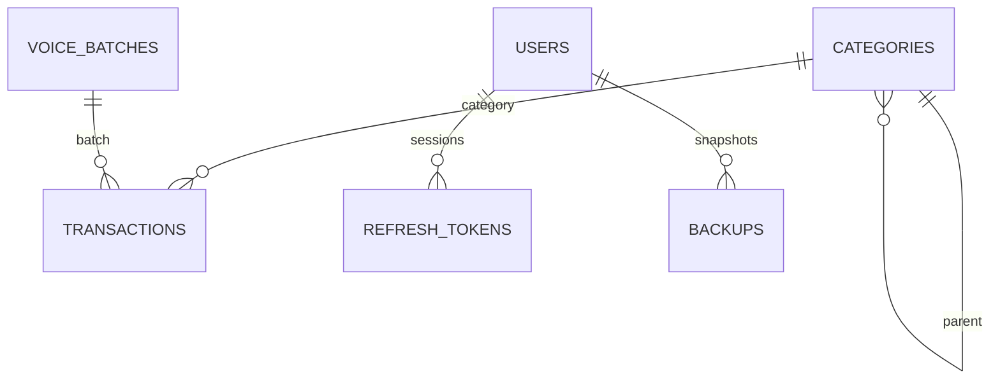

# 数据模型与迁移

字段基线以 [技术架构的本地/服务端数据表](./09-technical-architecture.md#53-本地数据表) 为唯一结构来源。本文件只补充关系、约束、迁移和恢复规则，避免重复维护字段清单。

## 1. 核心关系

- 一级分类 `parent_id = NULL`，二级分类引用一级分类。
- 交易只引用分类 ID；分类改名不改写历史显示。
- 同一语音批次共享 `voice_batch_id`，`voice_entry_index` 保留原始顺序。
- 服务端 `users` 不直接关联交易明细，交易只存在于加密备份对象。

## 2. 领域不变量

- `amount_minor > 0` 且为整数；退款和冲正使用收入分类表达。
- `type` 只有 `expense/income`。
- `currency` MVP 固定 `CNY`。
- 一级分类必须与交易 `type` 一致，二级分类必须属于该一级分类。
- 语音批次 1–5 笔；所有条目必须在同一 SQLite 事务中写入。
- 缺金额时不能入账。
- `occurred_at` 存 UTC，日分组按设备当前时区计算。
- 软删除后列表和统计默认过滤，但备份保留 `deleted_at` 供撤销和审计。
- 分类被引用后不可物理删除，只能归档。

## 3. 查询与索引

- 账本首页：按 `occurred_at` 降序取当前月；索引 `(deleted_at, occurred_at DESC)`。
- 日明细：按本地日起止换算 UTC 范围。
- 月度聚合：先取当前月交易，再在纯领域函数中聚合，避免 SQL 与展示重复实现规则。
- 语音撤回：按 `voice_batch_id` 一次查询；仅撤销未单独修改的条目。
- 分类排序：`(type, parent_id, sort_order)`。

## 4. SQLite 迁移

1. 每个 schema 变化新增 migration，不修改已发布 migration。
2. 迁移在事务中执行；失败回滚，不更新 `schema_migrations`。
3. App 启动时读取版本并顺序应用。
4. 升级前创建内部备份；成功迁移后保留至下一次成功启动。
5. 任何迁移都必须覆盖：空库、上一版本 fixture、已有自定义分类、软删除账单。

## 5. 备份与恢复

- 备份格式字段以 [技术架构](./09-technical-architecture.md#65-备份格式) 为基线。
- 上传前把 JSON 规范化、计算 checksum、gzip。
- 服务端校验格式版本、大小、计数和 checksum，再写入私有对象存储。
- 下载后在临时库重放；全部通过才替换当前 SQLite。
- 恢复不会自动合并两份账本。本机有数据时必须由用户选择覆盖或放弃。

## 6. 数据保留

- 本地账本：用户主动删除前保留。
- 录音：请求完成即删除，不进入数据库。
- 转写：只在请求内存中存在，不持久化。
- 云备份：每账号保留最近一份有效快照；旧对象在事务成功后清理。
- 登录令牌：refresh token 只保存哈希，到期或撤销后清理。
- 语音额度：按安装哈希和日期保留计数，不保存原始安装 ID。
